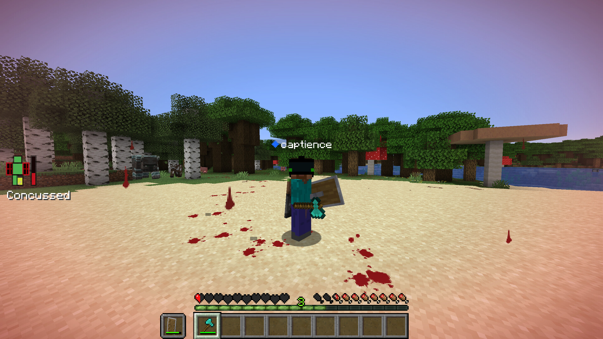
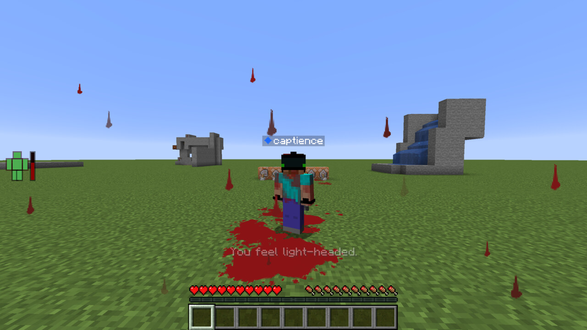
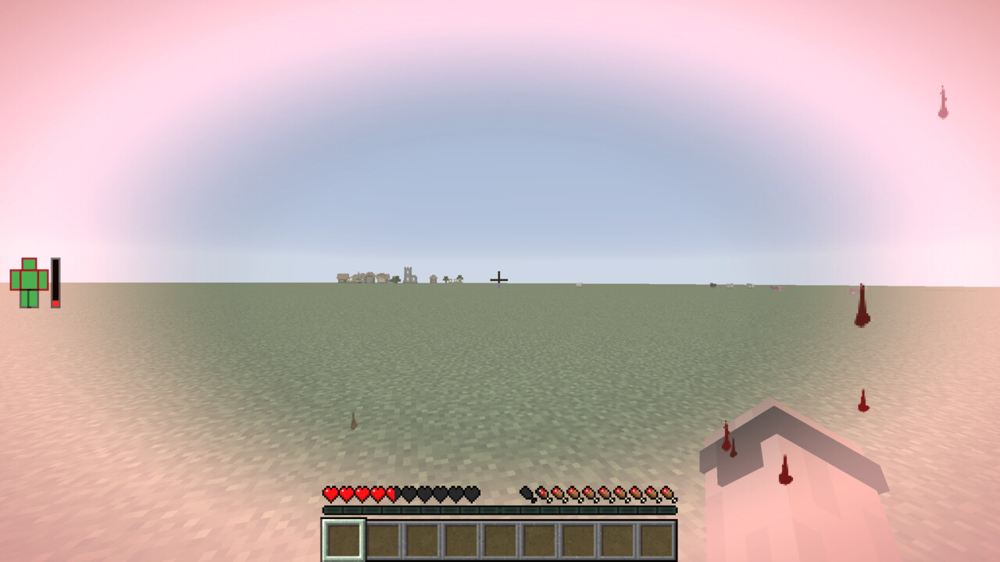
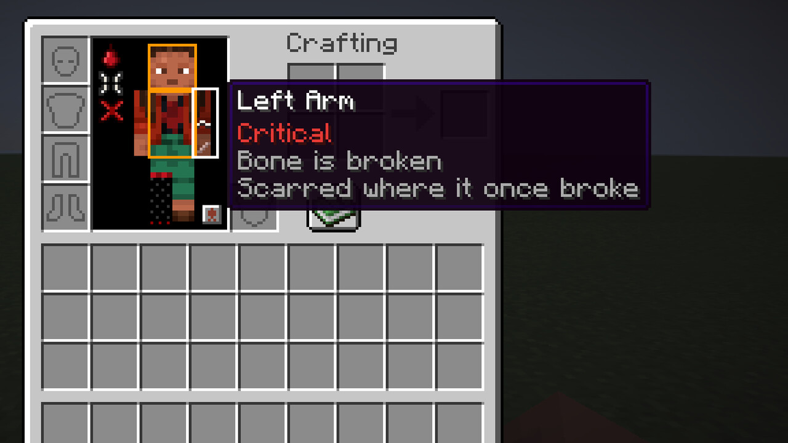
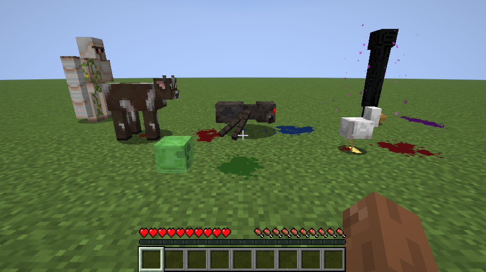
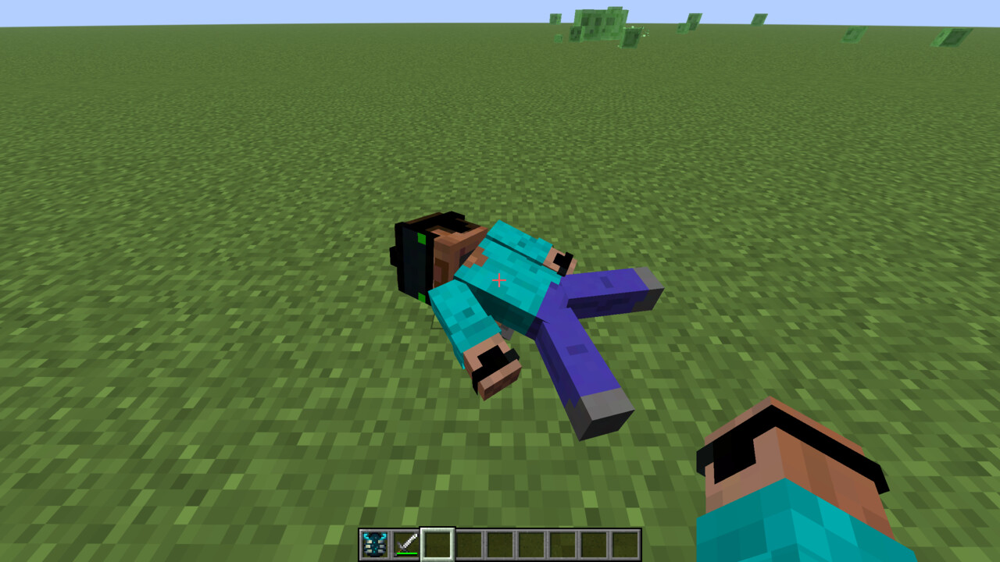
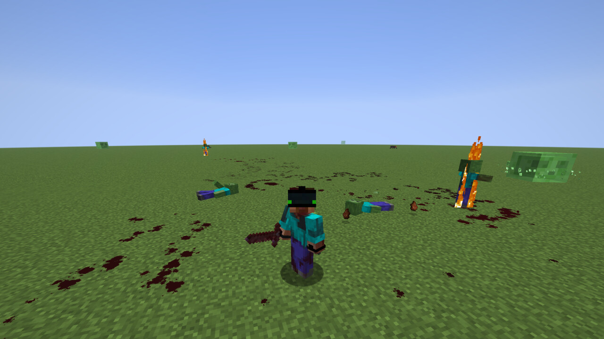

<div align="center">


# Realistic Damage

**Minecraft, but damage is cooler.**


</div>



Vanilla damage is a number going down. Realistic Damage adds a body underneath it: where
you got hit, how badly that part of you works now, whether you're bleeding, and whether
you can stay conscious. The vanilla heart bar stays completely in charge of life and death.

> "I survived the fall, but both legs are wrecked."
>
> "I still had seven hearts, but those arrows made me black out."
>
> "The creeper didn't kill me, but I was concussed and could barely fight."

**Contents:** [What it looks like](#what-it-looks-like) ·
[What it does](#what-it-does) ·
[Status](#status) ·
[Code tour](#code-tour) ·
[Building and testing](#building-and-testing) ·
[Server settings](#server-settings) ·
[Commands](#admin--debug-commands) ·
[Docs map](#docs-map)

## What it looks like

<table>
  <tr>
    <td width="50%" align="center">
      <br>
      <b>Blood you can see.</b> Drops fall, land and mark what they hit.
    </td>
    <td width="50%" align="center">
      <br>
      <b>Going under is a slide.</b> Colour drains, the view warps, sound dulls.
    </td>
  </tr>
  <tr>
    <td width="50%" align="center">
      <br>
      <b>The body readout</b> lives in the inventory's own player box.
    </td>
    <td width="50%" align="center">
      <br>
      <b>Mobs have bodies too,</b> and bleed in their own colour.
    </td>
  </tr>
  <tr>
    <td width="50%" align="center">
      <br>
      <b>Deaths that look like deaths.</b> Bodies stumble, fall and stay.
    </td>
    <td width="50%" align="center">
      <br>
      <b>A fight leaves marks:</b> on the ground, on you, on the blade.
    </td>
  </tr>
</table>

## What it does

- **Six body regions.** Head, torso, both arms and both legs each wear down from Healthy
  to Disabled. A hurt arm mines and fights slower; hurt legs cost you your sprint.
- **Real hit location.** Arrows use their actual impact point and melee traces the
  attacker's swing, left versus right included.
- **Deterministic injuries.** No fracture rolls, ever. Identical hits produce identical
  outcomes.
- **Blood and Consciousness.** Two hidden meters, only ever named by band ("heavy loss",
  "fading"), never shown as numbers.
- **Limbs can be lost,** heads included. Stumps show on the model and in first person,
  and the limb lands in the world.
- **Falls land like falls.** Severity comes from the drop, not from what your armour let
  through. Necks can break; whiplash lingers.
- **Afflictions.** Graded concussions, hypoxia, blast deafness, lost grip, adrenaline and
  its crash.
- **Every mob has a body.** All vanilla mobs take regional trauma through one of fourteen
  body plans, picked by data tag. Blood colour is a tag too.
- **Active ragdolls.** A small physics simulation in plain Java drives the vanilla model:
  bodies stagger a few steps and go over instead of tipping like a plank.
- **Rescue.** Drag a downed player, press a wound shut, feed someone who can't use their
  hands.
- **Food is the cure** in the core mod. The optional **field kit** (about forty items in
  two switchable halves, Weapons and Medicine, both off by default) is the only place
  bandages and splints exist.
- **Everything sensory has a slider,** and one button turns it all off.

The long version, written for players, is in [docs/PLAYER_GUIDE.md](docs/PLAYER_GUIDE.md).

## Status

This is an **alpha**. It gets played and tested constantly, and things still change under it.

| | Where it stands |
|---|---|
| This branch | 2.0 alpha, **Minecraft 26.2**, Fabric Loader 0.19.3, Fabric API 0.158.0+26.2, Java 25 |
| Last tagged release | `v1.6.2` (Minecraft 26.2) |
| Runs on | Client and server. A Fabric server needs it, and so does everyone joining it |
| VR | Built for Vivecraft: effects are drawn per eye, lost arms show as stumps, controllers get haptics |
| Minecraft 26.3 | Ported on a separate line, not merged here yet |

## Code tour

About 42,000 lines of server and shared code, 32,000 of client code and 11,000 of tests.
If you are here to read it, this is the short way in.

### The idea in one paragraph

The server owns everything. Each living thing with a body carries a mutable, persistent
`RealisticDamageData` attachment that is **never** sent to clients. A second, immutable
and quantized `BodySnapshot` attachment is derived from it, deduplicated by equality and
synced to every client tracking that entity. One-shot moments (an impact, a landing, a
sound, a death, a corpse) travel as small custom payloads. The client only presents:
blood, poses, camera, sound and HUD are all computed locally from the snapshot.

### The damage pipeline

```
vanilla damage happens (armour, enchantments, resistance, absorption: all vanilla)
  └─ AFTER_DAMAGE: post-mitigation amount, source, blocked flag
       ├─ classify → DamageCategory + DamageProfile       damage/DamageClassifier
       ├─ locate   → projectile point / melee ray / env   damage/BodyHitResolver
       ├─ trauma   → condition loss, break check,         damage/TraumaPipeline
       │             localized armour, limb shock
       ├─ wounds   → deterministic, by threshold          systems/BleedingSystem
       └─ mind     → head trauma, blunt, blast, falls     systems/ConsciousnessSystem
```

Body parts never soak vanilla damage. `AFTER_DAMAGE` does not fire for a killing blow, so
anything that reacts to the lethal hit hangs off `ALLOW_DEATH` and is confirmed in
`AFTER_DEATH`.

### Where things live

Everything is under `dev.captience.realisticdamage`. The common source set is `src/main`,
the client is `src/client`, unit tests are `src/test`.

| Package | What is in it |
|---|---|
| `body/` | The data model: `BodyPart`, `BodyState`, `RealisticDamageData`, `BleedWound`, `BodyPlan` (the fourteen mob layouts), `Vitals` (band wording shared by server and client) |
| `damage/` | The pipeline above, plus the special cases: falls, breaks, destruction, decapitation, broken necks, lethal blasts, corpses, knockdowns |
| `systems/` | What ticks: bleeding, consciousness, concussion, healing, impairment, adrenaline, rescue, mob anatomy. Also the pure maths (`*Math`, `Cardio`, `BloodFlow`), kept free of Minecraft types so it unit-tests without a game |
| `net/` | `BodySnapshot` (the versioned wire record) and the one-shot payloads |
| `ragdoll/` | The ragdoll simulation: an XPBD solver in `physics/`, the six-body humanoid rig, muscles, the stepping and stumbling controllers |
| `fieldkit/` | The optional items, behind their two switches: `brew/`, `medicine/`, the gating (`Gate`, `Half`, `SwitchedRecipe`) |
| `config/` | `ServerConfig` (the settings table below) and `Balance` (every tuning constant, in one file) |
| `command/` | `/rdmg`. Its `config` subcommand is generated by reflection from `ServerConfig`, so a new setting shows up without wiring |
| `api/` | The small integration API ([API.md](API.md)) |
| `mixin/` | Server-side mixins. Client ones are in `client/mixin/`, Vivecraft-only ones load through their own config |
| `gametest/` | Server game tests (in `src/main`, registered in `fabric.mod.json`) |
| `client/` | Presentation only: blood (`Blood*`), the HUD and inventory readout (`BodyHud`, `BodyInspector`), consciousness and concussion effects, camera (`CameraMotion`, `DeathCamera`), ragdoll drawing (`RemoteCorpses`, `RagdollCorpse`), audio (`audio/SoundDirector`), settings (`ClientEffectsConfig`) |

Good places to start: `RealisticDamage.java` (what gets registered),
`damage/DamageHooks.java` and `damage/TraumaPipeline.java` (a hit, end to end),
`systems/TickDispatcher.java` (what runs every tick), `net/BodySnapshot.java` (exactly
what a client is told), `config/Balance.java` (the numbers).

### Rules the code holds itself to

- **No randomness in outcomes.** Where variety is wanted (which way a body falls), it is
  seeded from stable facts like an entity id.
- **Blood and Consciousness are never shown as figures,** anywhere, including with
  "Exact Numbers" on.
- **Data over code.** Which mobs have bodies, their body plan, their blood colour and how
  a damage type is classified are all tags (`data/realisticdamage/tags/`), so a datapack
  can change them.
- **Nothing that deletes itself.** Blood on an item is stored in vanilla `custom_data`,
  not a mod component, so removing the mod never deletes the item.
- **Injury sounds ship as recipes or synthesis,** never as samples. The Arcade set layers
  and re-pitches vanilla sounds at run time; the Grounded set is synthesised by
  `tools/audio/`.

## Building and testing

Needs **Java 25**.

```sh
./gradlew build              # the jar, in build/libs
./gradlew test               # unit tests (pure maths and codecs)
./gradlew runGametest        # server game tests, headless
./gradlew runClient          # a dev client
./gradlew runClientGametest  # client game tests: boots worlds and takes screenshots
```

`runClientGametest` opens a real game window. Run it under `xvfb-run` if you don't want
it on your screen.

A clean checkout has no pain screams. They are imported locally from an owned copy of
Team Fortress 2 (`tools/import_tf2_screams.py`) and are never committed; the mod builds
and runs without them.

## Server settings

`config/realisticdamage-server.json`, generated on first run. Every one is also on the
**World rules** page in game:

| Setting | Default | Effect |
|---|---|---|
| `bodyDamageMultiplier` | 1.0 | Scales all body-condition trauma |
| `bleedingRateMultiplier` | 1.0 | Scales blood loss |
| `consciousnessLossMultiplier` | 1.0 | Scales consciousness drain |
| `healingMultiplier` | 1.0 | Scales all recovery |
| `fallTraumaMultiplier` | 1.0 | Scales fall trauma specifically |
| `pvpTraumaMultiplier` | 1.0 | Scales trauma from other players |
| `enableLimbDestruction` | true | Arcade preset: limbs can be destroyed permanently |
| `enableExplosiveDismemberment` | true | Extreme TNT and creeper trauma can take the nearest limb outright; nested under limb destruction |
| `enableDecapitation` | true | An edge on an already-Disabled head takes it off (anything else still crushes it), the most violent lethal blasts throw it, and the head can be picked up and placed but never worn; nested under limb destruction |
| `enableBrokenNecks` | true | A limp or gliding body landing head first, a dive into water one block deep, an elytra into a wall at speed or a huge blunt blow to the head snaps the neck: instant death, no totem saves it, bosses are immune. Off, those only ever give whiplash |
| `enableWhiplash` | true | The same causes under the bar, and hard knockdowns, leave the neck stiff for 30 to 90 s: players turn their view slower and quick turns hurt, mobs turn and aim worse |
| `enableLongTermInjuries` | false | Worst injuries permanently lower a region's healing ceiling by state band |
| `enableMobAnatomy` | true | Mobs in the `realisticdamage:has_anatomy` tag (humanoids by default) take regional trauma, bleed, break, lose limbs and collapse like players |
| `spawnSeveredLimbs` | true | A lost limb is thrown into the world, lands, bleeds for a minute and is gone; nested under limb destruction |
| `enableKnockdown` | true | Hard landings put you on the ground for a moment |
| `knockdownFromBlows` | true | A blast or a heavy blow that does not kill knocks you down too (with `enableKnockdown`) |
| `enableMicrosleeps` | true | Consciousness cuts out in episodes on the way down |
| `disabledArmsLoseGrip` | true | An arm driven to Disabled can't grip until it heals: no raised shield or item use in that hand, no bows/crossbows/spears, and a limp main arm fights like a missing one |
| `enableAdrenaline` | true | Dropping to the last two hearts gives a few seconds of adrenaline (faster, pain masked), then a crash (heavy legs, short winded sprints) |
| `softenFallLethality` | true | Compresses vanilla's lethal fall tail so long drops maim rather than delete |
| `unconsciousAggro` | `NEARBY` | Who notices a body on the floor. `ATTACKERS` keeps whatever was already fighting you, `NEARBY` adds anything within 6 blocks that can see you, `ALL` pulls in every hostile with line of sight, `NONE` takes you off the menu entirely |
| `preyOnWounded` | `VISIBLE` | Which visible injuries hostiles prefer: `OFF`, `DOWNED`, `LIMPING`, or `VISIBLE` (limping and bleeding) |
| `enableBleeding` / `enableBrokenLimbs` / `enableConsciousness` / `enableBurns` / `enableHitLocation` | true | Turn whole systems off |
| `enableBloodiedItems` | true | A held weapon or tool that opens a wound, lands in one or kills keeps the blood on it: it dries from red to brown over half a minute and stays until rain or standing water rinses it off. Only things that don't stack |
| `enableWeapons` | false | The field kit's Weapons half: poisons, trick arrows, traps and the gear that answers them. Off, none of it can be made or found and any already held does nothing |
| `enableMedicine` | false | The field kit's Medicine half: bandages, splints, tourniquets and other treatment. Off, food and time are the only cure |

Every tuning constant lives in one file (`config/Balance.java`) so rebalancing never means
hunting magic numbers.

## Admin & debug commands

`/realisticdamage` (alias `/rdmg`), requires permission level 2 or the
`realisticdamage:command/debug` node:

```
/rdmg info [target]                        show all hidden values
/rdmg heal [targets]                       full reset
/rdmg set <targets> <part> <value>         set a part's condition
/rdmg set <targets> blood <0-100>
/rdmg set <targets> consciousness <0-100>
/rdmg damage <targets> <part> <amount>     apply test trauma
/rdmg break <targets> <part>               fracture an arm or leg; head = break the neck
/rdmg destroy <targets> <part>             destroy a part outright
/rdmg behead [targets]                     take the head off
/rdmg bleed <targets> <part> <severity>
/rdmg whiplash [targets] [0-1]
/rdmg concussion <targets> [mild|moderate|severe|none]
/rdmg burn <targets>
/rdmg blast <targets> <limb> [radius]      test a localized explosion beside a limb
/rdmg ceiling <players> <part|all> <band>  set max/hurt/injured/critical recovery
/rdmg scar <players> <part> <level>        set none/broken/destroyed history
/rdmg config <setting> [value]             inspect or change any server setting
/rdmg preset <arcade|grounded>             switch the server-side preset
```

Every verb reads the same way: the verb, then who, then which part, then how much
(`/rdmg break Steve head`, `/rdmg set @s blood 40`). "Who" is any selector: players
always, and any mob with anatomy (`@e[type=zombie,limit=1,sort=nearest]`).

## For mod authors

[API.md](API.md) covers integration. The short version: add your damage type to a
`realisticdamage:ballistic` (or `slash`, `blunt`, ...) tag in a datapack and it is
classified, with no dependency in either direction. There is a small API for the cases a
tag can't answer: categories that vary at run time, and supplying an exact hit point for
hitscan weapons that have no projectile to reconstruct from.

## Docs map

| File | What it is |
|---|---|
| [docs/PLAYER_GUIDE.md](docs/PLAYER_GUIDE.md) | Every feature, in full, written for players |
| [DESIGN.md](DESIGN.md) | Architecture and the balance tables |
| [API.md](API.md) | Integration for other mods and datapacks |
| [ROADMAP.md](ROADMAP.md) | Release by release: what shipped and what is next |
| [2.0_PLAN.md](2.0_PLAN.md) | The 2.0 plan: heads and necks, the field kit |
| [RAGDOLL_PLAN.md](RAGDOLL_PLAN.md), [IK_PLAN.md](IK_PLAN.md) | The ragdoll and stumbling-death designs, with what each phase taught |
| [AUDIO_PLAN.md](AUDIO_PLAN.md) | The two sound sets and the sound director |
| `TESTING_*.md`, `RAGDOLL_TESTING.md`, `AUDIO_TESTING.md` | Playtest checklists, newest on top. Working notes, not documentation |
| `tools/` | The generators for textures, the icon and the synthesised sounds |
| `publish/` | The store listing's text and gallery |

## License and credits

[CC0 1.0](LICENSE): public domain. Take what is useful.

Designed, directed and playtested by captience. The code, generated art and text were
written with [Claude Code](https://claude.com/claude-code).
